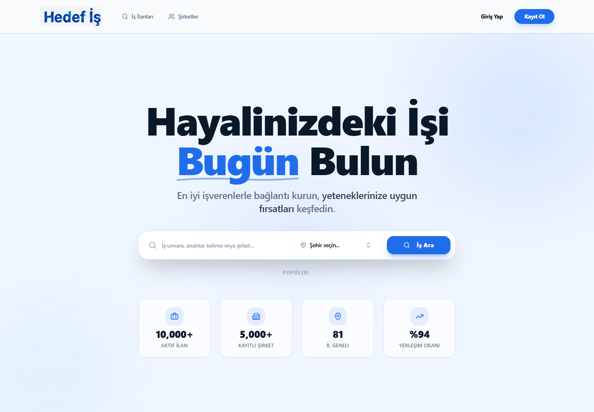
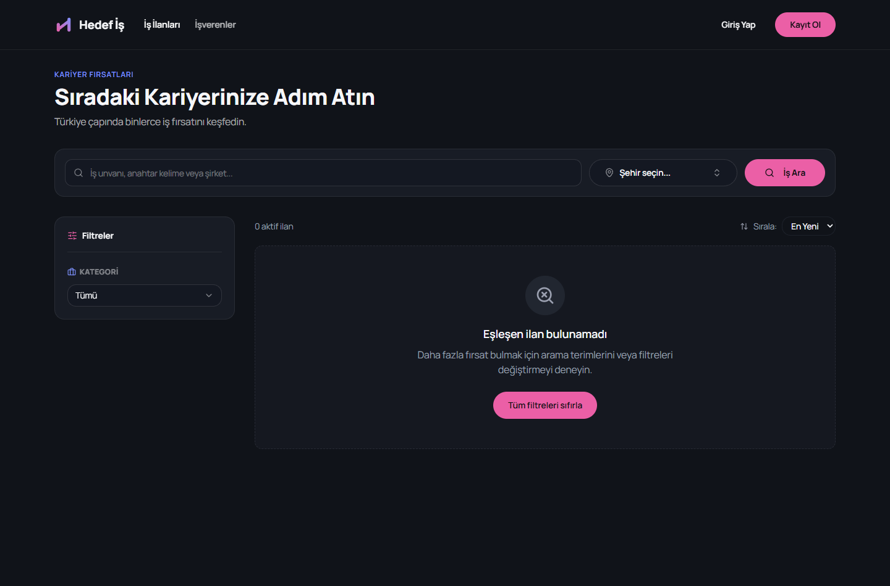
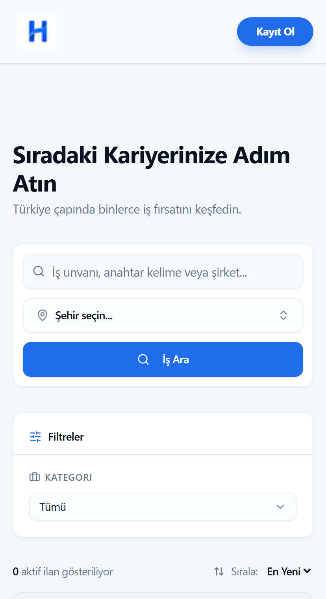
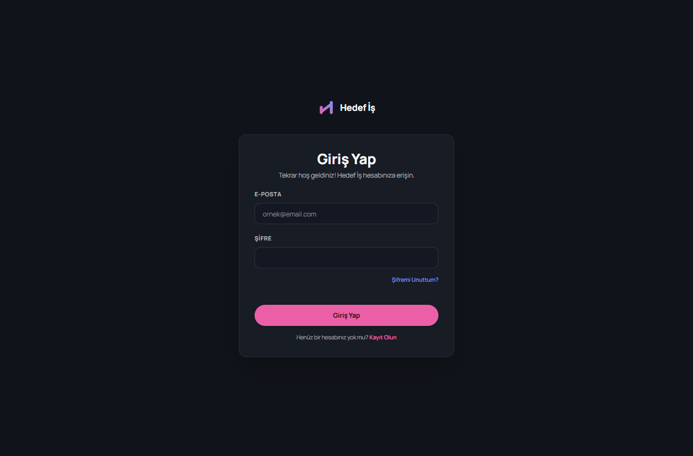
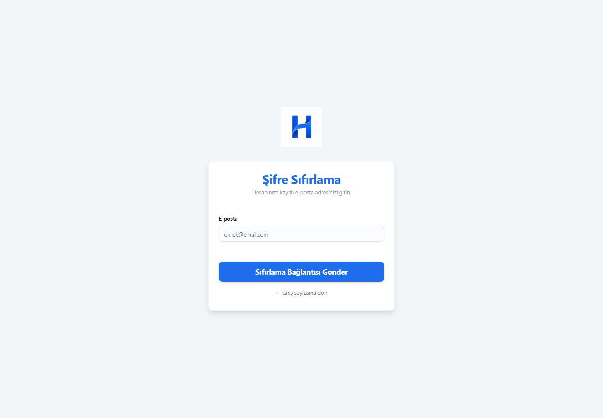
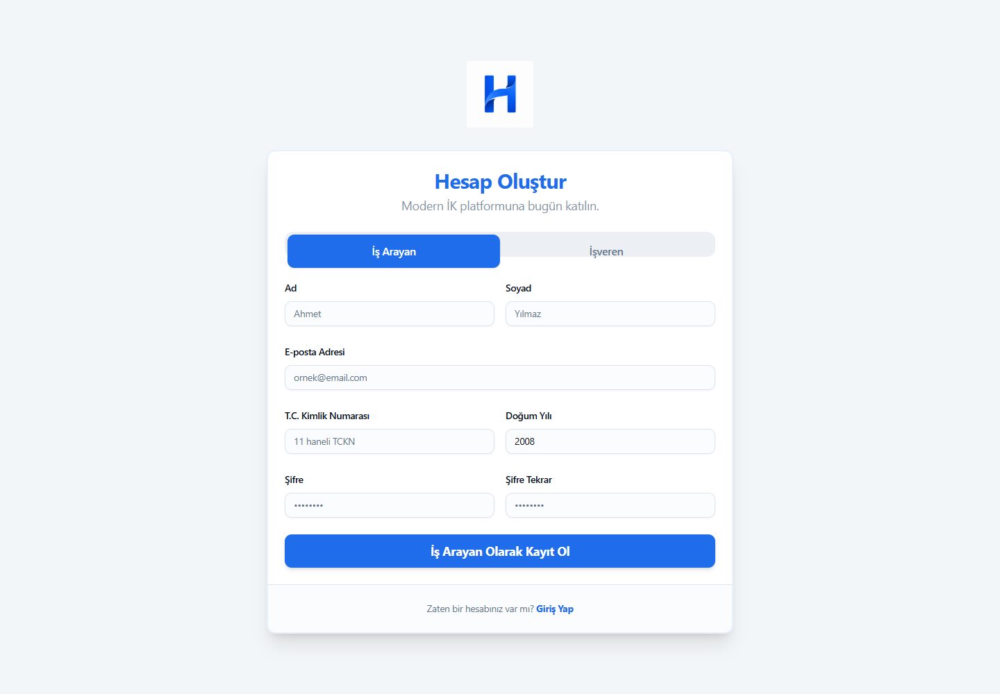
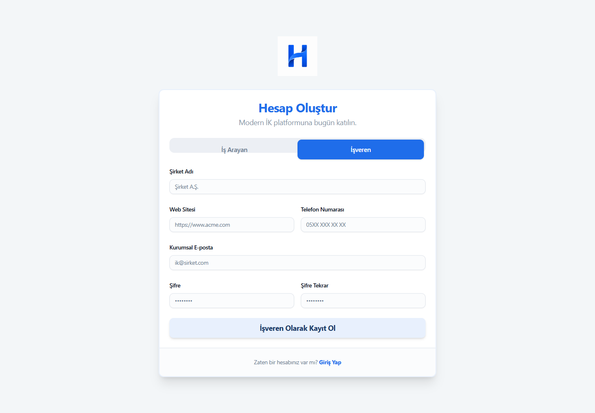
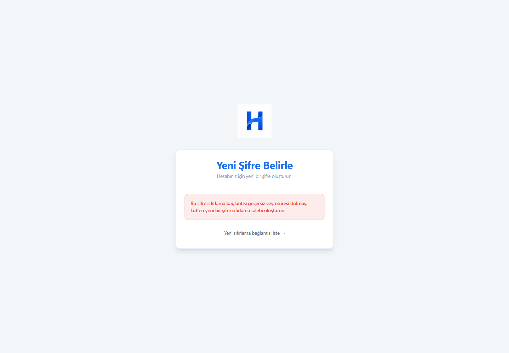

# Hedef İş — Modern HRMS & Applicant Tracking Platform Frontend

<div align="center">


**A high-performance, dark-themed Single Page Application (SPA) for a modern job marketplace — featuring advanced job search with pagination, multi-role registration (Job Seeker / Employer), comprehensive résumé builder, and dedicated employer hiring portal.**

</div>

---

## 📸 Ekran Görüntüleri (Screenshots)

Uygulamanın yeni koyu tema tasarım sistemi ve modern cam efektli (glassmorphic) arayüzünden güncel görüntüler (1440 × 950 masaüstü ve 414 × 896 mobil görünüm).

### Aday Deneyimi (Job Seeker Experience)

#### Ana Sayfa (Landing Page)
100vh koyu zemin, yıldızlı güven rozeti, güçlü tipografi, pembe aksan butonlar ve 3D eğimli, interaktif arama konsolu (kategori sekmeleri, şehir filtreleme, popüler etiketler ve önerilen ilanlar).



#### İş Arama & İlan Listesi (`/jobs`)
Arama çubuğu, şehir filtresi, kategori ve çalışma şekli filtreleri, sayfalama (sayfa başı 10 ilan kontrolü) ve listeleme kartları.



#### Mobil Responsive Görünüm
Küçük ekranlarda tek sütunlu akış, tam uyumlu dokunma hedefleri ve açılır mobil menü.



---

### Kimlik Doğrulama & Güvenlik (Authentication)

| Giriş Yap (`/login`) | Şifre Sıfırlama Talebi (`/forgot-password`) |
|:---:|:---:|
|  |  |

#### Çift Rol Kayıt Ekranı (`/register`)
Tek sayfada Radix Tabs ile ayrılmış iki farklı form şeması: İş arayanlar için kişisel ve kimlik bilgileri, işverenler için kurumsal şirket bilgileri.

| Aday Kaydı (İş Arayan) | İşveren Kaydı (Şirket) |
|:---:|:---:|
|  |  |

#### Güvenli Şifre Yenileme Muhafızı (`/reset-password`)
Geçersiz veya süresi dolmuş token ile gelen isteklerde güvenli durum uyarı ekranı.



---

## 🚀 Proje Yetenekleri & Mimari Özet

**Hedef İş**, hem iş arayan adaylar hem de yetenek avcısı işverenler için tasarlanmış çift taraflı bir İK platformudur.

| Fonksiyonel Alan | Açıklama | Durum |
|---|---|---|
| **Modern Tasarım Dili** | Manrope tipografisi, koyu zemin (`#101319`), kartlar (`#181c25`), marka pembesi (`#eb5fa6`) ve lavanta aksanlar (`#7d92ff`). | ✅ Aktif |
| **İş Arama & Filtreleme** | Başlık, şirket, şehir, kategori, çalışma şekli ve sayfa başı 10 ilanlık pagination. | ✅ Aktif |
| **İlan Detayı & Başvuru** | Şirket kartı, pozisyon gereksinimleri ve tek tıkla başvuru yapabilme. | ✅ Aktif |
| **Aday Özgeçmiş Oluşturucu** | 7 sekmeli detaylı profil (Özet, Sosyal Ağlar, İletişim, Deneyimler, Eğitim, Yetenekler & Diller, CV Yükleme). | ✅ Aktif |
| **Başvuru Takibi (Aday)** | Başvurulan pozisyonların güncel durumlarını (Kabul, Red, Beklemede) izleme. | ✅ Aktif |
| **İlan Yayınlama Portalı (İşveren)** | Şirket adına pozisyon gereksinimleri, çalışma modeli ve son başvuru tarihi belirterek ilan açma. | ✅ Aktif |
| **Aday Değerlendirme (İşveren)** | Gelen başvuruları filtreleme, aday profillerini inceleme ve Kabul/Red aksiyonları. | ✅ Aktif |
| **Şirket Profili & Dizini** | Tüm işverenlerin vitrin sayfaları ve şirket bazlı açık pozisyon listesi. | ✅ Aktif |

---

## 🏗️ Mimari ve Klasör Yapısı (Feature-Sliced Design)

Proje, genişletilebilirliği artıran ve karmaşıklığı azaltan alan bazlı (feature-sliced) modüler bir mimariyle yapılandırılmıştır:

```
src/
├── app/                         # Uygulama çekirdeği
│   ├── App.tsx                  # QueryClientProvider, RouterProvider, Toaster
│   ├── router.tsx               # createBrowserRouter rota ağacı
│   └── components/
│       ├── ProtectedRoute.tsx   # Rol ve oturum koruması
│       └── layout/              # Navbar, Footer ve AppLayout
├── features/                    # İşlevsel modüller (Feature Slices)
│   ├── auth/                    # Giriş, kayıt, şifre kurtarma, authService, useAuthStore
│   ├── jobs/                    # Arama, detay, ilan verme, işveren başvuruları
│   ├── applications/            # Aday başvuru takip ekranı
│   ├── profile/                 # Aday ve işveren profil sayfaları, CV yönetimi
│   ├── employers/               # İşveren listeleme ve şirket vitrin sayfası
│   ├── home/                    # Hero, öne çıkan ilanlar, şirketler ve CTA bölümleri
│   └── categories/ cities/ …    # Referans veri kancaları (hooks) ve bileşenleri
├── components/                  # Paylaşılan UI bileşenleri
│   ├── ui/                      # Radix + Tailwind atomik bileşenler (Button, Card, Input vb.)
│   └── common/                  # HedefIsLogo, SectionHeader, JobCard, PaginationControls
├── lib/                         # Harici kütüphane konfigürasyonları (apiClient, queryClient)
└── shared/                      # Yardımcı fonksiyonlar, doğrulamalar ve sabitler
```

---

## ⚡ Durum Yönetimi & Veri Akışı

1. **Sunucu Durumu (Server State) — TanStack Query (React Query v5):**
   - Tüm REST API çağrıları için otomatik önbellekleme (5 dk `staleTime`).
   - `mutation` sonrası ilgili query anahtarlarının geçersiz kılınması (`invalidateQueries`) ile anında güncellenen arayüz.
   - İyimser güncellemeler ve yükleme iskeletleri (skeletons).

2. **İstemci Oturum Durumu (Client/Session State) — Zustand:**
   - Kimlik doğrulama belirteci (JWT) ve kullanıcı profil/rol bilgisi `useAuthStore` içinde tutulur.
   - `persist` ara yazılımı ile `localStorage` üzerinde senkronize edilir.
   - Axios `apiClient` istek dinleyicisi (interceptor) belirteci doğrudan mağazadan okur ve `Authorization: Bearer <token>` başlığıyla iletir.

3. **Tip Güvenli Form Yönetimi — React Hook Form + Zod:**
   - Tüm formlar Zod şemaları ile doğrulanır; TypeScript türleri `z.infer` ile türetilir.
   - Hata mesajları Türkçe ve alan bazlı olarak sunulur.

---

## 🛠️ Teknoloji Yığını

| Katman | Teknoloji / Kütüphane | Amaç |
|---|---|---|
| **Framework** | React 18 / 19 + TypeScript 5.9 | Tip güvenli reaktif kullanıcı arayüzü |
| **Build Tool** | Vite 7.3 | Hızlı geliştirme ortamı (HMR) ve optimize üretim derlemesi |
| **Routing** | React Router DOM v7 | İstemci tarafı sayfa yönlendirmesi ve rota muhafızları |
| **Sunucu Durumu** | TanStack Query v5.90 | Asenkron veri getirme, önbellek ve mutasyonlar |
| **Global Durum** | Zustand 5.0 | Oturum ve kimlik doğrulama durumu |
| **Stil & Tasarım** | Tailwind CSS 3.4 + Radix UI Primitives | Erişilebilir, koyu temalı tasarım sistemi |
| **Form & Validasyon** | React Hook Form + Zod | Güçlü form yönetimi ve şema doğrulaması |
| **HTTP İstemcisi** | Axios 1.13 | İstek/yanıt dinleyicileri (interceptors) |
| **İkonlar & Animasyon** | Lucide React + Framer Motion | Modern mikro animasyonlar ve vektör ikon seti |
| **Bildirimler** | Sonner | Zengin toast bildirimleri |

---

## 💻 Kurulum ve Yerel Geliştirme

### Gereksinimler
- **Node.js**: `20.19+` veya `22.12+`
- **npm**: `9+` (veya pnpm / yarn)

### Kurulum Adımları

```bash
# 1. Depoyu klonlayın
git clone https://github.com/kamiltuncok/hrms-frontend.git
cd hrms-frontend

# 2. Bağımlılıkları yükleyin
npm install

# 3. Ortam değişkenlerini yapılandırın
cp .env.example .env

# 4. Geliştirme sunucusunu başlatın
npm run dev
```

Uygulama yerel olarak **http://localhost:5173/** (veya port meşgulse `http://localhost:5174/`) adresinde çalışmaya başlar.

---

## ⚙️ Ortam Değişkenleri (.env)

Proje kök dizinindeki `.env` dosyasında arka uç servis adresini belirtebilirsiniz:

```env
# Backend Spring Boot API Base URL
VITE_API_URL=http://localhost:8080
```

> **Not:** Vite ortam değişkenlerini derleme anında koda gömdüğü için `.env` dosyasındaki değişikliklerden sonra geliştirme sunucusunu yeniden başlatmanız önerilir.

---

## 📦 Üretim Derlemesi (Production Build)

```bash
# Tip kontrolü ve üretim paketi oluşturma
npm run build

# Üretim paketini yerel olarak önizleme
npm run preview
```

`dist/` klasörüne derlenen statik dosyaları barındırırken SPA rotalarının doğru çalışması için sunucunuzda (Nginx, Netlify, Vercel vb.) tüm bilinmeyen yolları `index.html`'e yönlendirecek (rewrite) yapılandırmayı uygulayınız.

---

## 📄 Lisans

Bu proje [LICENSE](LICENSE) dosyası altında lisanslanmıştır.
